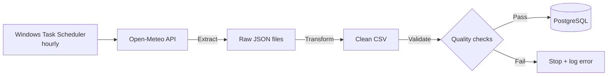

# Bengaluru Air Quality ETL Pipeline

An hourly batch pipeline that ingests air-quality data for Bengaluru from the
Open-Meteo API, cleans and validates it, and loads it into PostgreSQL —
building a deduplicated historical dataset that the source API itself does not keep.

## Architecture



## Tech stack
Python · pandas · PostgreSQL · psycopg2 · Windows Task Scheduler

## Key design decisions

- **Raw data saved first** — every API response is stored before processing,
  so data can be reprocessed if transformation logic changes.
- **Forecast removal** — the API mixes measured and forecast values in one
  response; only hours up to the current time are kept.
- **Idempotent loading** — a composite primary key `(measured_at, latitude, longitude)`
  with `INSERT ... ON CONFLICT DO UPDATE` means re-running never creates duplicates.
- **Self-healing** — each run fetches a 7-day window, so missed runs
  (e.g. laptop off) are backfilled automatically on the next run.
- **Secrets management** — database credentials are kept in `.env`, never in code.

## Data quality checks
The pipeline stops before loading if any rule fails:
1. Dataset is not empty
2. No negative pollutant values
3. No physically implausible values (e.g. PM10 > 1000 µg/m³)
4. PM2.5 ≤ PM10 (PM10 includes all PM2.5 particles)
5. No future timestamps or duplicate hours

## Sample insight
Average carbon monoxide peaks between **5 PM and 9 PM**, consistent with
evening traffic and reduced atmospheric mixing after sunset.

## How to run
```bash
pip install -r requirements.txt
cp .env.example .env        # then add your PostgreSQL password
# create the table using create_table.sql in your PostgreSQL database
python run_pipeline.py
```

## Note on data
Values come from Open-Meteo's atmospheric model, not physical monitoring stations.

## Next steps
- Orchestrate with Apache Airflow in Docker
- Add CPCB ground-station data as a second source
- Build a dashboard on the historical data